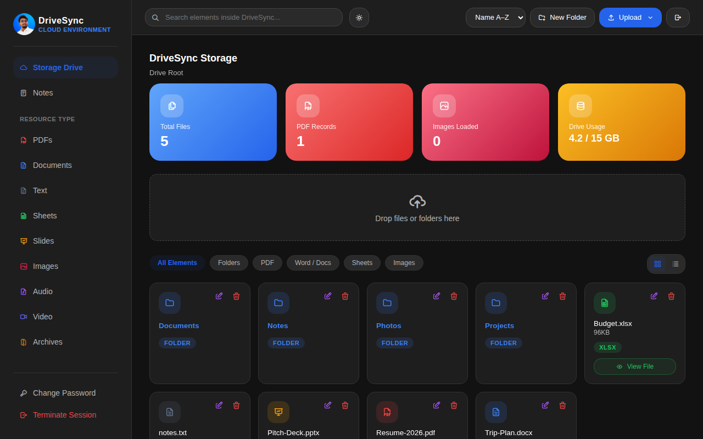
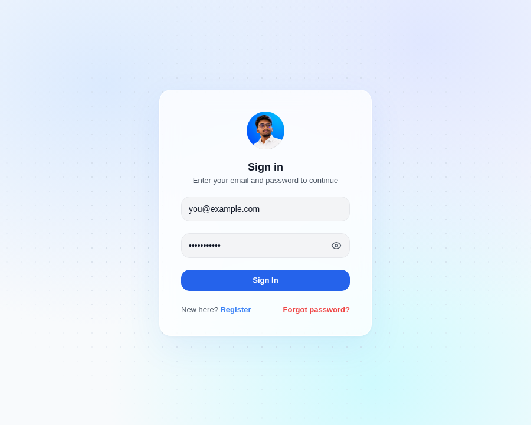
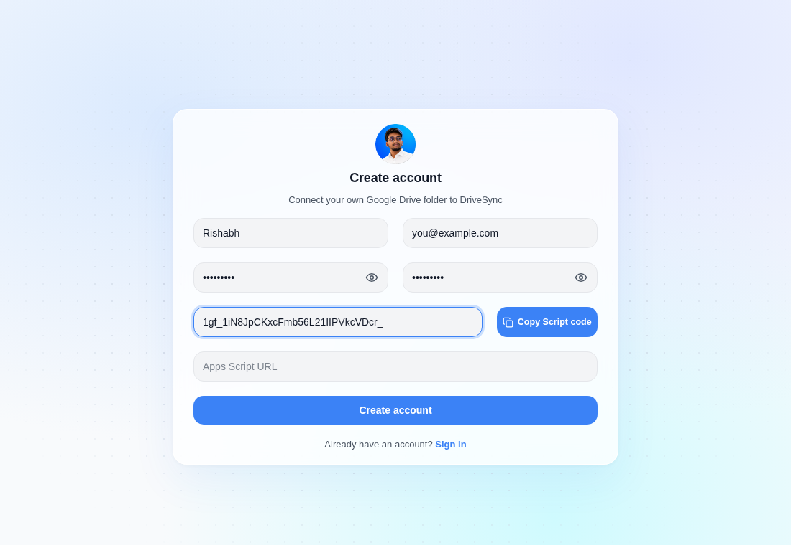
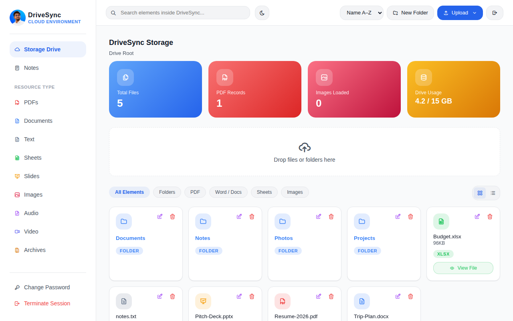
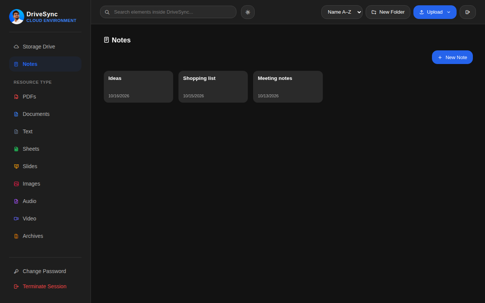
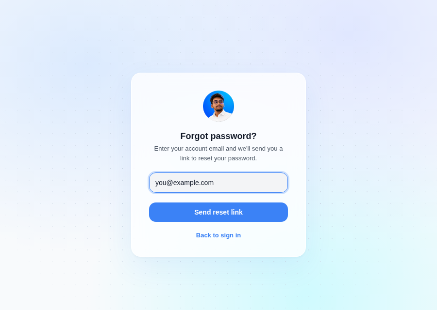

<div align="center">

# DriveSync

**A personal cloud dashboard where every account is backed by its own Google Drive folder.**

React · Vite · Vercel Serverless · MongoDB Atlas

</div>

<p align="center">
  
</p>

## Features

- **Email + password login** with scrypt-hashed passwords and signed session tokens
- **Sign in with Google or email + password** – Google users can set a password later and use both
- **Bring your own storage** – users connect their own Google Drive with one tap (OAuth, `drive` scope); no script or folder ID to set up. See [docs/GOOGLE_SETUP.md](docs/GOOGLE_SETUP.md)
- **Self-service sign-up** with a one-click *Copy Script code* helper for the Drive setup
- **Forgot password** by email – reset link valid for 10 minutes, single use
- **Drive browser** – folders, upload, preview, search, grid / list view, light & dark theme
- **Notes** stored as text files inside your Drive
- **Admin panel** to manage accounts, feature access and appearance
- **Installable** as a PWA on mobile

## Screenshots

| Sign in | Create account |
|:---:|:---:|
|  |  |

| Dashboard (light) | Notes |
|:---:|:---:|
|  |  |

| Forgot password |
|:---:|
|  |

## Quick start

```bash
npm install
cp .env.example .env     # fill in the values below
npm run dev
```

| Command | Purpose |
|---|---|
| `npm run dev` | Start the dev server |
| `npm run build` | Production build |
| `npm run preview` | Preview the build |
| `npm run lint` | Lint with oxlint |

## Environment variables

Google sign-in/Drive adds `GOOGLE_CLIENT_ID`, `GOOGLE_CLIENT_SECRET` (and optional `APP_URL`, `TOKEN_ENC_KEY`) – see [docs/GOOGLE_SETUP.md](docs/GOOGLE_SETUP.md). `.env.example` lists everything.


Set these in `.env` locally and in **Vercel → Settings → Environment Variables**.

| Variable | Description |
|---|---|
| `MONGODB_URI` | MongoDB Atlas connection string |
| `MONGODB_DB` | Database name (default `drivesync`) |
| `ADMIN_PASSCODE` | First-time admin panel passcode |
| `SESSION_SECRET` | Long random string used to sign login tokens |
| `SMTP_HOST` `SMTP_PORT` `SMTP_USER` `SMTP_PASS` | SMTP details for reset emails (Gmail: use an App Password) |
| `MAIL_FROM` | Sender address for reset emails |
| `APP_URL` | Public site URL, e.g. `https://mydockerr.vercel.app` (no trailing slash) |

## Setup

1. **Database** – create a free MongoDB Atlas cluster and allow `0.0.0.0/0` under *Network Access*. `vercel.json` sets the function region to `bom1`; change it if your cluster is elsewhere.
2. **Deploy** – import the repo on Vercel and add the environment variables.
3. **First account** – open `/adminaccount`, enter `ADMIN_PASSCODE`, and add an account. Or let users register themselves at `/register`.
4. **Drive bridge** – on the register page paste your Drive folder link, click **Copy Script code**, create a project at [script.google.com](https://script.google.com), paste the code and deploy it as a Web app (execute as *Me*, access *Anyone*), then paste the Web app URL back.

## Pages

| Route | Page |
|---|---|
| `/` | Sign in and drive dashboard |
| `/register` | Create account |
| `/forgot-password` · `/reset-password` | Password reset |
| `/theme` | Appearance settings |
| `/adminaccount` | Admin panel |
| `/setup` | Apps Script setup guide (older accounts only) |

## Project structure

```
api/         Vercel serverless functions (auth, register, reset, admin…)
lib/         Server helpers (db, accounts, passwords, sessions, mailer)
src/pages/   React pages
src/lib/     Client helpers (notes, sync, session)
src/styles/  Page CSS
backend/     Code.gs – Apps Script bridge (only for older Apps Script accounts)
lib/google.js, api/google.js   Google OAuth (sign in + connect Drive)
src/lib/driveBridge.js         Drive API bridge used by the dashboard
tests/       npm test
public/      Icons and PWA manifest
scripts/     hash-password.mjs, test-mail.mjs
```

## Security notes

- Passwords are hashed with scrypt and never stored in plain text.
- Session tokens last 30 days and stop working when the account is deleted or its password changes.
- Never commit `.env`; keep secrets only in Vercel and your local file.

## License

Private project – not licensed for redistribution.
